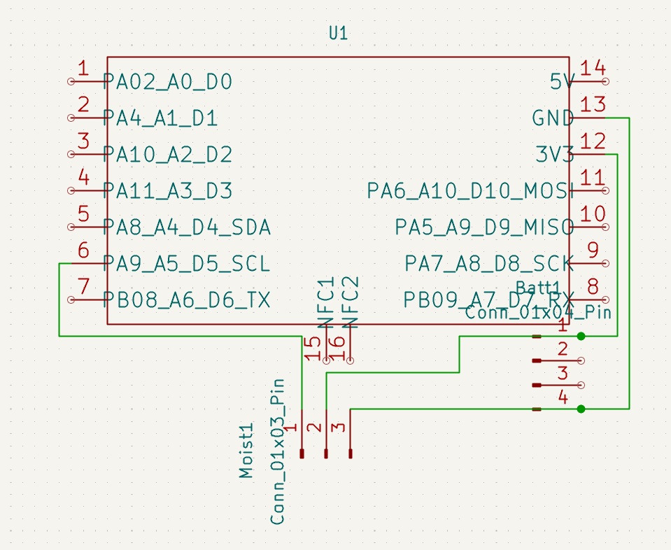
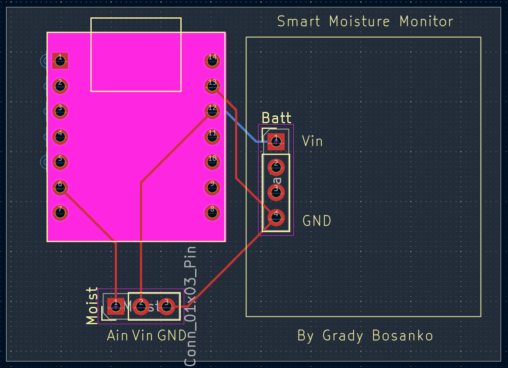
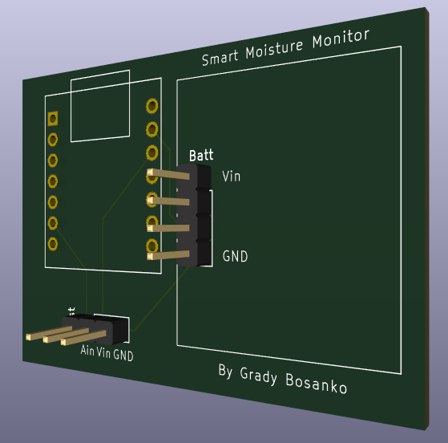

# BLE Soil Moisture Monitor
A simple BLE project to transmit soil moisture data to a companion app.

## Problem Statement

Every time I try to take care of a plant, I find myself unsure of when to water it. Not watering it enough leads to the plant drying up and withering, while watering it too much prevents oxygen from reaching its roots, suffocating it. To fix this problem, I have designed a BLE soil moisture monitor that allows me to check the current moisture as a percentage from my phone.

## Demo

This is the final assembled PCB.

This shows the device embedded in a plant's soil.

The scanner is part of the nRF Connect app, which is used to connect to the device via Bluetooth. From this app, the GATT services and characteristics can be observed.

Here, the GATT service is demonstrated. From the app, the user can check whether they have notifications enabled, and see the current soil moisture reading as a percentage (48% in this example). A moisture around 50% is optimal, since 0% indicates that the plant is underwatered and 100% indicates that the soil is saturated.

## Components

The design consists of 3 components: a XIAO nRF52840 microcontroller, a Soldered capacitive soil moisture sensor, and an Adafruit coin cell battery holder. 

[[Product link]](https://www.digikey.com/en/products/detail/seeed-technology-co-ltd/102010632/26553897?so=101749953&content=productdetail_row&mkt_tok=MDI4LVNYSy01MDcAAAGkY9oCX9iygtz4pVAQxpqr9ZmE4g0C6yautcUlOLW5aC9xsgBlqE6x3ocl_qvb9IpdeQ0vp1-dXrSFhxRcrpanjOP8NQ_jjrDhp60iZ-v--p0)
The XIAO microcontroller was selected because of its built-in BLE capabilities, ultra low power consumption, and cheap price. 

[[Product link]](https://www.digikey.com/en/products/detail/soldered-electronics/333098/22494271?so=101749953&content=productdetail_row&mkt_tok=MDI4LVNYSy01MDcAAAGkY9oCX76sH_zutGff5qTR9hXQQgZbCBUYd4em5-yhrqD2zff5iIO-SuaSxgmhp9wLsde382XFEWzbwsMcbW_gcRJmSAfn9ZwdCsp4ZNgJ9eU)
The capacitive soil moisture sensor was chosen because the resistive sensors are prone to corrosion and become inaccurate over time whereas the capacitive sensors do not. 

[[Product link]](https://www.digikey.com/en/products/detail/adafruit-industries-llc/1870/6827145?so=101749953&content=productdetail_row&mkt_tok=MDI4LVNYSy01MDcAAAGkY9oCX-3YfHN_4Pn0ITYmxmNeIwlKKb93PmJDG6CmgtwscsC1Zk4IxDnRYwAyWlH3y9Dge1PSLhRw2X4eO3y6CPP56ea1Lo7lolS804_4SQE)
The coin cell battery holder was necessary to supply the device with power, enabling remote operation. A coin cell battery is the ideal choice because of their small form factor and impressive battery capacity given their size.

## Implementation

[Firmware Architecture image (state machine)]

## Challenges Faced

This project required me to learn many new technologies in order to assemble everything. One of the biggest roadblocks I faced was settling on a design when I had little experience working with BLE or ULP devices. Ultimately, I opted to keep the hardware simple and focus more on gaining depth in my software knowledge. This made it easier to test each component individually, allowing me to minimize potential points of failure while designing the firmware for the device. 

[Flow chart of testing stages]

In fact, the firmware could be designed in sections to work with each component before combining everything together. Specifically, I loaded a sample blink program onto the microcontroller, modified a sample BLE button notification program to work with my hardware, modified a USB serial monitor example to verify the soil moisture sensor readings, and tested powering the device using the battery rather than the USB cable. Isolating components and gradually building up towards the completed final product made the task of learning many new technologies more manageable.

## Battery Estimate

$$
\text{Charge}_{\text{daily}} =
(10 \times 0.2) +
(0.1 \times 23.8) +
(0.0005 \times 23.8) +
(5 \times 0.004)
$$

$$
\boxed{\text{Charge}_{\text{daily}} = 4.52\ \text{mAh/day}}
$$

The above equation shows how the device's power consumption for a day was estimated. This assumes that the device is actively transmitting sensor readings for 12 minutes a day, which is more than likely an overestimate as the readings arrive within seconds. 

The first value in the equation represents the 10mA of current drawn during these 12 minutes of activity, which is listed on the [XIAO microcontroller datasheet](https://files.seeedstudio.com/wiki/XIAO/Seeed-Studio-XIAO-Series-SOM-Datasheet.pdf) as the active current draw. 

Next, according to the [Nordic Semiconductor online power profiling tool](https://devzone.nordicsemi.com/power/w/opp/2/online-power-profiler-for-bluetooth-le), the nRF52840 draws about 100uA of current when advertising over BLE, which is represented by the next values. 

Similarly, the idle current draw listed on the [XIAO microcontroller datasheet](https://files.seeedstudio.com/wiki/XIAO/Seeed-Studio-XIAO-Series-SOM-Datasheet.pdf) is a mere 5uA, which provides the next value.

The final value in the equation comes from the amount of time that the moisture sensor is actively drawing current and getting a reading from the soil. The exact current value of the sensor used is not listed on the datasheet, so a value from a [similar capacitive soil sensor](https://media.digikey.com/pdf/data%20sheets/dfrobot%20pdfs/sen0193_web.pdf) is used in its place.

Since the sensors polls every 10 seconds, and is inactive while the device does not have an active BLE connection, this is almost a negligable value.

Finally, we divide the listed battery life of a 2032 coin cell battery, 220-240mAh, by the daily battery consumption to arrive at an estimated battery life of 50 days. It should be noted that this estimate is based on the design outlined in the future work section, where a MOSFET is used to prevent the sensor from drawing current while the microcontroller is idle.

## Future Work
In the future, I would further improve the power management with the addition of two main features. The first would be an on/off switch for the coin cell battery power supply. Some components come with this pre-installed, and this would have been an ideal choice for my use case.

The second improvement I would make would be adding a MOSFET transistor between the power supply and the moisture sensor so that the sensor can only pull current when digitally enabled. This would significantly improve the battery life because the current drawn by the sensor is orders of magnitudes larger than that of the microcontroller while the microcontroller is in low-power mode.
